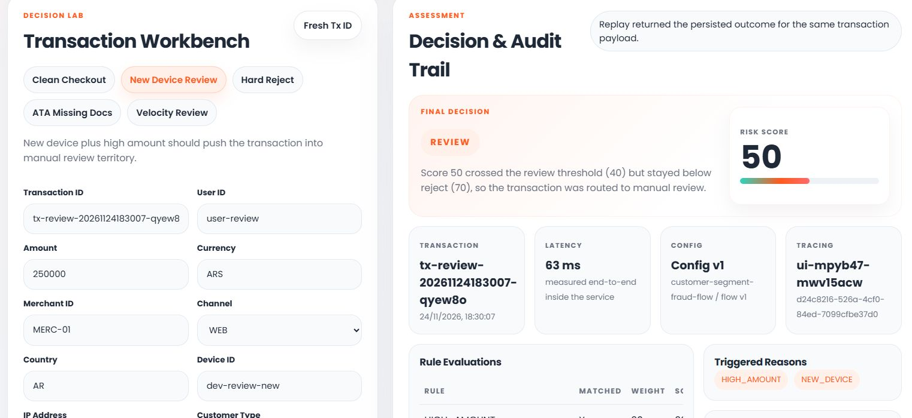

# Lautaro Cortez

**Software engineer · Backend systems, data pipelines, and product engineering**

I build software for workflows where data must be reliable and decisions need to be explainable.

[Portfolio](https://lautarocortez.com/) · [LinkedIn](https://www.linkedin.com/in/lgiaroli/)

## Featured project — Fraud Decision Engine

A local-first Java 21 and Spring Boot app that evaluates simulated transactions with versioned rules, returns an explainable decision, and records an audit trail. Repeating the same request replays the result. Reusing a transaction ID with a different payload is rejected.

[View code and quickstart](https://github.com/lGiaroli/fraud-decision-engine-java#local-experience) · [Architecture](https://github.com/lGiaroli/fraud-decision-engine-java/blob/main/docs/architecture.md) · [Tests](https://github.com/lGiaroli/fraud-decision-engine-java/tree/main/src/test/java/com/portfolio/frauddecisionengine)

To try it, start the app locally, select **New Device Review**, and then replay the same request from the transaction workbench.

## Selected independent work

| Project | What I built |
| --- | --- |
| **[Foco Vivo](https://lautarocortez.com/projects/foco-vivo)** | A wildfire triage workspace for Córdoba that normalizes satellite observations, groups signals into events, and gives operators context for human review. |
| **[Alqag](https://lautarocortez.com/projects/alqag)** | A rental search tool that deduplicates listings from multiple sources and shows how precise each map location is. |
| **[Family Garden](projects/desktop.md#family-garden)** | A Rust desktop editor that preserves original vector artwork and turns repeated illustration work into editable projects and batch SVG exports. |
| **[Aurobit](https://aurobitstudio.com/)** | A published storefront with an administration panel for managing the product catalog and categories. |
| **[Bruma](projects/desktop.md#bruma)** | A Windows PDF reader with internal reference navigation and a back action that restores the exact reading position. |
| **[RopeFit](https://lgiaroli.github.io/ropefit-timer/)** | An interval-training app for jump rope, built with Expo and React Native. [Source code](https://github.com/lGiaroli/ropefit-timer). |

## Professional experience

At Lateral, I work across software engineering and QA on the V4-to-V6 migration. My work includes the case workspace and visual workflow editor, import and ETL flows, and financial workflows. I also designed and built [Lateral Time](https://lautarocortez.com/projects/lateral-time), an internal platform for time tracking, approvals, and reporting.
